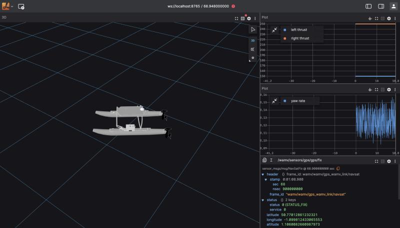
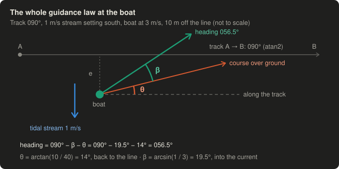

# solent-usv

I'm building a simulated **autonomous surface vessel (USV)** that plans and follows routes across the **Solent** (Portsmouth, Southampton and the Isle of Wight). It runs on **ROS 2 Jazzy** in the **VRX** (Virtual RobotX) simulator on **Gazebo Harmonic**. I write the whole guidance, navigation and control (GNC) stack myself, and every route plan uses real open data: depth, tide height and buoyage.

> Work in progress.

> [!WARNING]
> **Not for navigation.** This is a simulation and portfolio project. The bathymetry, seamarks and tide data it uses are coarse, incomplete and possibly out of date, and I process them in simplified ways. Never use anything in this repository to plan or navigate a real vessel. Use official charts (UKHO/ADMIRALTY), Notices to Mariners and proper passage planning.

## What I'm building
- A WAM-V from VRX in a georeferenced Solent world.
- My own GNC stack, with no Nav2 and no third-party autopilot, because I want to understand every layer from the inside: an A\* route planner on the chart, line-of-sight (LOS) guidance, heading and speed PID loops, and actuator allocation for the two thrusters. I already used Nav2 in my [warehouse-nav2](https://github.com/adricampos10/warehouse-nav2) project; a boat is a different problem, with large inertia, no brakes, and drift from wind and tidal current.
- Chart-aware planning from real bathymetry and predicted tide: anywhere shallower than the boat's draft plus a safety margin is a no-go area, so a route that is open at high water is blocked at low water.
- Tidal current compensation: the guidance combines a feedforward course to steer, worked out from the predicted tidal stream, with integral LOS for whatever the prediction gets wrong.
- Avoidance of predicted traffic: ferry and ship trajectories from my other project, Solent live traffic, plus the COLREGs and the Moving Prohibited Zone around large ships.
- YAML scenarios with metrics and GitHub Actions CI, growing with every milestone.

I write everything in Python first. Once the whole demo works, I may port the guidance and control loop to C++ and check that both versions give the same results.

## Roadmap
1. **VRX in Docker** *(done, see [Milestone 1](#milestone-1-vrx-in-docker))*. The VRX `jazzy` branch (ROS 2 Jazzy + Gazebo Harmonic) runs headless in Docker on my Mac, with a WAM-V that I can drive and watch in Lichtblick through `foxglove_bridge`.
2. **Guidance and control.** LOS guidance between waypoints and heading and speed PID loops that ask for a surge force and a yaw moment, in Python and unit-tested with pytest. A separate actuator allocation layer turns that force and moment into left and right thrust, within each thruster's limits (in VRX, about 2350 N ahead but only 1000 N astern); it is the only part that knows which boat it drives. The boat follows a straight track and a dog-leg in calm water, and I record the runs to show it joins the track the way the LOS geometry below predicts. The first scenarios and the CI start here.
3. **Chart and A\* planner.** I download an EMODnet DTM tile for the Solent and turn it into a cost grid where depth < draft + margin is forbidden. My own A\* plans a route across it, for example from Portsmouth to Cowes without touching the shallows.
4. **Tides.** I add the predicted tide height to the charted depth (both referenced to chart datum, roughly LAT), so the grid changes with time. A scenario checks that the same route passes at high water and fails at low water.
5. **Tidal currents.** VRX simulates wind and waves but not current, and in the Solent the tidal stream often matters more than the wind. I generate my own current field, with strength and direction following the tide (flood, ebb, springs and neaps), and a Python node applies it to the boat through Gazebo's wrench topic. Gazebo's water doesn't move, so the node applies the drag the hull would feel from its speed relative to the moving water, not a fixed push. The compensation goes in the guidance, not in the forces: a uniform current doesn't push the boat, it carries it, so what has to change is the heading. Then I compare three ways of crossing the same current:
   - **Homing**, with the bow always pointed at the destination: the boat drifts down-tide and follows a curve.
   - **Plain LOS**: the boat stays parallel to the track, but offset from it.
   - **Feedforward course to steer + integral LOS**: the boat goes straight down the track and converges sooner. I learned to work out the course to steer as a Day Skipper, with the tidal vector triangle; here the guidance does the same with the predicted current: desired heading = track angle + asin(cross-track current / speed through the water), plus the LOS and integral terms.
6. **Traffic and COLREGs.** First, simulated targets and the steering rules (Rules 13–15) with CPA/TCPA checks. Then predicted traffic from Solent live traffic:
   - My other project, [Solent live traffic](https://maritime.notjustrobotics.com), a live map of the area, learns the usual routes of ferries and large ships from AIS and predicts where each one will be over the next 10 minutes. The plan is to learn routes on shore and predict on board.
   - The boat downloads a versioned route package whenever it has a connection and keeps the last copy. On board, it runs the same prediction code on AIS from its own receiver, so it needs no internet and has low latency.
   - A ROS 2 bridge node turns the data into layers of the cost grid. Ferry and ship corridors become high-cost areas, and the Moving Prohibited Zone around large ships in the Precautionary Area becomes forbidden.
   - Predictions become moving obstacles with future trajectories, so the planner can time a perpendicular crossing of a ferry corridor, following Rules 9 (narrow channels) and 10 (traffic separation schemes).
   - AIS never replaces the boat's own sensors, because many small boats don't carry it.
7. **IALA A buoyage** *(optional)*. Lateral and cardinal marks from OpenSeaMap become constraints, so the boat keeps the correct side of each channel.
8. **C++ port** *(optional)*. I port LOS/ILOS guidance, the PID loops and the actuator allocation to C++ (rclcpp), and run the same test cases on both versions to check they give the same results.
9. **Monohull** *(optional)*. Most working USVs are monohulls, and a single-engine monohull can't turn on the spot. I first write a 3-degree-of-freedom manoeuvring model in Python (Fossen, with a Nomoto model for the steering response) to test allocation and LOS with pytest in seconds. Then I model the hull in Gazebo with a steerable outboard and compare both models on the same zigzag manoeuvre, identifying the hydrodynamic coefficients from turning-circle and zigzag tests. Only the allocation layer changes, from differential thrust to throttle and steering angle; with a limited steering angle and little thrust, the boat can't make a yaw moment, which is what underactuated means in practice. Then I run the same scenarios.

## Milestone 1: VRX in Docker
I build VRX v3.1.2 from source on ROS 2 Jazzy ([`docker/vrx/Dockerfile`](docker/vrx/Dockerfile)), so the same image runs natively on my arm64 Mac and on amd64 in CI. Gazebo Harmonic comes from the ROS vendor packages.

Two changes from VRX's defaults made it run in real time without a GPU:
- **My own WAM-V** ([`models/wamv_solent.urdf.xacro`](models/wamv_solent.urdf.xacro)): VRX's hull, hydrodynamics and two aft thrusters, but only the sensors in my physical architecture, GNSS and IMU. VRX's competition boat also carries three cameras and a 3D lidar; rendered on the CPU, they slowed the simulation to under 2 % of real time.
- **My own world** ([`worlds/solent_open_water.sdf`](worlds/solent_open_water.sdf)): open water off Spithead with VRX's wind and waves, georeferenced so the GNSS reads Solent coordinates. VRX's Sydney world downloads its shore and buoy models from Gazebo Fuel every time it starts.

[`launch/sim.launch.py`](launch/sim.launch.py) starts both through VRX's own launch helpers, with the boat at a chosen position and heading.

```bash
docker build -t solent-usv-vrx docker/vrx
scripts/run_smoke_test.sh     # unit tests + smoke test; exits 1 if a check fails
```

The smoke test ([`scripts/smoke_test.py`](scripts/smoke_test.py)) applies 400 N to both thrusters for 20 s, then ±300 N to turn on the spot. It checks the motion from the ground-truth pose. The checks themselves are pure Python ([`scripts/smoke_metrics.py`](scripts/smoke_metrics.py)), unit-tested with pytest. Results on my Mac (Apple Silicon, no NVIDIA GPU):

| Requirement | Check | Result |
|---|---|---|
| R1.1 Headless | `gz sim -s` in Docker, no GPU | Pass |
| R1.2 Real time | Real-time factor ≥ 0.5 | Pass: 1.00 |
| R1.3 Forward | ≥ 5 m forward within 20 s, equal thrust | Pass: 39.0 m |
| R1.4 Turn | Yaw rate towards the weaker thruster | Pass: +28.2 °/s, drifting only 0.7 m |
| R1.5 Visualisation | Pose visible in Lichtblick | Pass, checked by eye |

To watch the boat, I run the simulation with `foxglove_bridge` and the Lichtblick web viewer with my layout (3D view following the boat, thrust, yaw rate and GNSS fix), then open the URL that `run_viewer.sh` prints:
```bash
scripts/run_sim_viz.sh        # terminal 1
scripts/run_viewer.sh         # terminal 2
```
The 3D view draws the WAM-V from its URDF on `/wamv/robot_description`; `foxglove_bridge` serves the hull meshes to the browser from their `package://` paths.



## The physics behind the navigation
How the boat will hold a track across a tidal stream, which is what milestones 2 and 5 implement. It is the same reasoning as working out a course to steer on a chart, written as a guidance law.

### Heading is not course
- **Heading (ψ)** is where the bow points. It is what the heading controller steers.
- **Course over ground (χ)** is where the boat actually goes over the seabed.

With no current they are the same. With a cross current the boat crabs: it points one way and travels another. The guidance law works out the **desired heading** ψ<sub>d</sub> that makes the course over ground follow the track.

### The guidance law
```math
\psi_d \;=\; \chi_p \;-\; \arcsin\!\left(\frac{v_\perp}{U}\right) \;-\; \arctan\!\left(\frac{e + \kappa \int e \, dt}{\Delta}\right)
```

| Symbol | Meaning |
|---|---|
| χ<sub>p</sub> | Track angle: the direction of the leg from one waypoint to the next |
| v<sub>⊥</sub> | Component of the predicted current across the track, positive when it pushes the boat to starboard |
| U | Boat speed through the water |
| e | Cross-track error: distance from the track, positive to starboard |
| Δ | Look-ahead distance along the track |
| κ | Integral gain |

Angles are nautical (clockwise, positive to starboard), so both minus signs mean the same thing: steer into the current and back towards the track. Each term fixes a different problem.



**1. Track angle.** With no current and the boat on the line, pointing along the leg is enough. I work it out from the two waypoints with atan2(Δy, Δx), not arctan(Δy/Δx): the division loses the signs, so plain arctan can't tell a leg heading north-east from one heading south-west.



**2. Feedforward: the course to steer.** It corrects for the current *before* any error appears, using the predicted tidal stream. To stay on the line, the sideways part of the boat's velocity through the water has to cancel the current across the track. Pointing an angle β into the current gives a sideways velocity of U·sin β, so:
```math
U \sin\beta = v_\perp \quad\Rightarrow\quad \beta = \arcsin\!\left(\frac{v_\perp}{U}\right)
```
This is the tidal vector triangle from passage planning. At U = 3 m/s (about 6 knots) in a 1 m/s (about 2 knots) cross current, β = asin(1/3) ≈ 19.5° into the current. Speed over the ground along the track becomes U·cos β plus the along-track part of the current, and the speed controller deals with that. If the cross current is as fast as the boat (v<sub>⊥</sub> ≥ U), no heading can hold the track: the code has to detect it and flag it, and the planner should avoid that leg at that state of the tide. The term is only as good as the prediction: if the real stream is 1.2 m/s instead of 1.0, the boat needs 23.6° and gets 19.5°.



**3. Line-of-sight (LOS) guidance.** The feedforward keeps the boat *parallel* to the track; LOS brings it back onto it. The boat aims at a point a distance Δ ahead on the track. The angle θ between straight ahead along the track and the line to that point is the correction: the two legs of the triangle are Δ and e, so θ = atan(e/Δ) towards the line. At e = 10 m and Δ = 40 m that is 14°, and it fades smoothly to zero as the boat reaches the line. Why arctan and not a simple linear rule, turning in proportion to the distance off the track? Near the track they agree: for small angles atan(e/Δ) ≈ e/Δ, which with Δ = 40 m is about 1.4° per metre. But a linear rule keeps growing: at 1.4° per metre it passes 90° at 64 m off the track and turns the boat back the way it came. arctan can't: the aim point is always ahead, so θ stays below 90° however far off the boat is. Δ is the main tuning knob: short converges fast but can oscillate, long is smooth but slow. A usual starting point is 2 to 5 boat lengths, 10 to 25 m for the WAM-V.



**4. Integral LOS (ILOS).** With a forecast error of 4°, the boat settles off the track at the distance where the LOS correction makes up those 4°, and stays there. The integral of the cross-track error keeps growing while that offset lasts, until it covers the missing angle and the error goes back to zero. It mops up any steady error: a wrong tidal forecast, leeway from the wind, model errors. Its risk is windup: after a large error, such as a turn at a waypoint or a collision-avoidance manoeuvre, it can overshoot the line. So I only integrate close to the track, clamp the integral, and reset it on each new leg.

### A worked example
Track 090° (due east), 1 m/s current setting south (pushing the boat to starboard), U = 3 m/s, boat 10 m to starboard of the line, Δ = 40 m:

| Term | Value | Desired heading |
|---|---|---|
| Track angle | 090° | 090° |
| Feedforward | −19.5° | 070.5° |
| LOS (e = 10 m) | −14° | **056.5°** |

The boat heads 056.5° and closes the line. Once on it, the LOS term drops to zero and the heading settles at **070.5°**: the boat crabs, but its course over ground is exactly 090°. If the forecast is off, the integral adds the missing degrees.

### Each term on its own
This is what milestone 5 compares in simulation, with recordings of each run to show the boat behaves as the trigonometry predicts:

| Method | In a cross current |
|---|---|
| Homing (bow always at the destination) | Swept down-tide; the path is a curve |
| LOS alone | Parallel to the track but offset from it, for good |
| LOS + integral | Back on the track, but slowly: it has to learn the whole current |
| Feedforward + LOS + integral | Straight from the start; the integral only trims |

In the Solent the stream changes with the tide during a passage, so the feedforward is recomputed all the time from the predicted current at the boat's position and the current time, and the integral only has a small residual to follow.

## System design (SysML v2, Arcadia levels)
Before I implement each milestone, I model it in **SysML v2 textual notation**, in [`docs/sysml/`](docs/sysml). I organise the model following the four levels of the Arcadia method, one file per level, linked by allocations, so every part of the design traces back to a need in the Solent:

| Level | File | Question it answers |
|---|---|---|
| 1. Operational analysis | [`1_operational.sysml`](docs/sysml/1_operational.sysml) | What happens on the Solent today: ferries, large ships, small craft, VTS, and the rules (COLREGs, IALA A, the Moving Prohibited Zone). The boat doesn't appear yet. |
| 2. System analysis | [`2_system.sysml`](docs/sysml/2_system.sysml) | What the USV must do, as a black box: its functions, interfaces and system requirements, each derived from a level-1 rule. |
| 3. Logical architecture | [`3_logical.sysml`](docs/sysml/3_logical.sysml) | Which technology-independent components do it (localisation, chart model, planner, collision avoidance...), with each system function allocated to one. |
| 4. Physical architecture | [`4_physical.sysml`](docs/sysml/4_physical.sysml) | What implements them: hardware (the VRX WAM-V) and ROS 2 nodes. It grows milestone by milestone. |
| Verification | [`verification.sysml`](docs/sysml/verification.sysml) | The simulation, the requirements of each milestone, and the tests that verify them. |

Because the model is plain text, it is versioned and reviewed in git like the code. I validate it and render its diagrams with the official OMG pilot implementation, running in Docker so I don't need Java on my Mac:
```bash
docker build -t solent-usv-sysml docker/sysml
docker run --rm -v "$PWD":/ws solent-usv-sysml python scripts/check_sysml.py
```
The script exits with an error if the model doesn't resolve, so it can run in CI.

| Logical architecture | Operating modes |
|---|---|
|  |  |

More views: [operational context](docs/sysml/diagrams/1_operational_context.svg), [system context](docs/sysml/diagrams/2_system_context.svg), [system requirements](docs/sysml/diagrams/2_system_requirements.svg) and [physical architecture](docs/sysml/diagrams/4_physical_architecture.svg).

## Data sources
| Data | Source | Licence | How I use it |
|---|---|---|---|
| Bathymetry | [EMODnet Bathymetry](https://emodnet.ec.europa.eu/en/bathymetry) DTM, about 115 m grid, depths referenced to LAT | CC BY 4.0 | Download once with a WCS request and store a small tile |
| Seamarks | [OpenSeaMap](https://www.openseamap.org/) `seamark:*` tags from OpenStreetMap, through the Overpass API | ODbL, © OpenStreetMap contributors | Query once and store a GeoJSON snapshot |
| Tides | [ADMIRALTY UK Tidal API](https://admiraltyapi.portal.azure-api.net/), Discovery tier (free) | UKHO terms | High and low water times and heights; needs a free API key |

I don't use Navionics or any other proprietary chart data.
