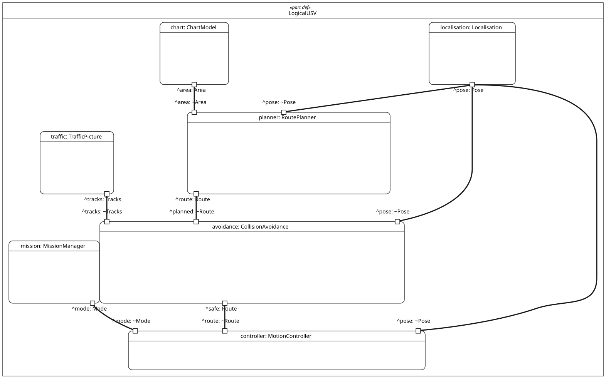
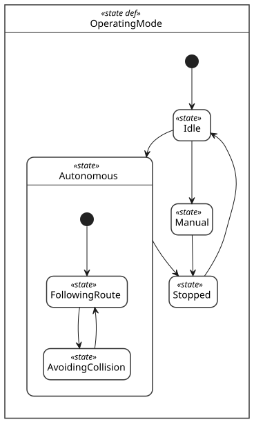

# solent-usv

I'm building a simulated **autonomous surface vessel (USV)** that plans and follows routes across the **Solent** (Portsmouth, Southampton and the Isle of Wight). It runs on **ROS 2 Jazzy** in the **VRX** (Virtual RobotX) simulator on **Gazebo Harmonic**. I write the whole guidance, navigation and control (GNC) stack myself, and every route plan uses real open data: depth, tide height and buoyage.

> Work in progress.

> [!WARNING]
> **Not for navigation.** This is a simulation and portfolio project. The bathymetry, seamarks and tide data it uses are coarse, incomplete and possibly out of date, and I process them in simplified ways. Never use anything in this repository to plan or navigate a real vessel. Use official charts (UKHO/ADMIRALTY), Notices to Mariners and proper passage planning.

## What I'm building
- A WAM-V from VRX in a georeferenced Solent world.
- My own GNC stack, with no Nav2 and no third-party autopilot, because I want to understand every layer from the inside: an A\* route planner on the chart, line-of-sight (LOS) guidance, heading and speed PID loops, and a thrust mixer for the two thrusters. I already used Nav2 in my [warehouse-nav2](https://github.com/adricampos10/warehouse-nav2) project; a boat is a different problem, with large inertia, no brakes, and drift from wind and tidal current.
- Chart-aware planning from real bathymetry and predicted tide: anywhere shallower than the boat's draft plus a safety margin is a no-go area, so a route that is open at high water is blocked at low water.
- Tidal current compensation: the guidance combines a feedforward course to steer, worked out from the predicted tidal stream, with integral LOS for whatever the prediction gets wrong.
- Avoidance of predicted traffic: ferry and ship trajectories from my other project, Solent live traffic, plus the COLREGs and the Moving Prohibited Zone around large ships.
- YAML scenarios with metrics and GitHub Actions CI, growing with every milestone.

I write everything in Python first. Once the whole demo works, I may port the guidance and control loop to C++ and check that both versions give the same results.

## Roadmap
1. **VRX in Docker.** The VRX `jazzy` branch (ROS 2 Jazzy + Gazebo Harmonic) runs headless in Docker on my Mac, with a WAM-V that I can drive and watch in Lichtblick through `foxglove_bridge`.
2. **Guidance and control.** A thrust mixer, heading and speed PID loops, and LOS guidance between waypoints, in Python and unit-tested with pytest. The boat follows a straight track and a dog-leg in calm water. The first scenarios and the CI start here.
3. **Chart and A\* planner.** I download an EMODnet DTM tile for the Solent and turn it into a cost grid where depth < draft + margin is forbidden. My own A\* plans a route across it, for example from Portsmouth to Cowes without touching the shallows.
4. **Tides.** I add the predicted tide height to the charted depth (both referenced to chart datum, roughly LAT), so the grid changes with time. A scenario checks that the same route passes at high water and fails at low water.
5. **Tidal currents.** VRX simulates wind and waves but not current, and in the Solent the tidal stream often matters more than the wind. I generate my own current field, with strength and direction following the tide (flood, ebb, springs and neaps), and a Python node applies it to the boat as an external force through Gazebo's wrench topic. Then I compare three ways of crossing the same current:
   - **Homing**, with the bow always pointed at the destination: the boat drifts down-tide and follows a curve.
   - **Plain LOS**: the boat stays parallel to the track, but offset from it.
   - **Feedforward course to steer + integral LOS**: the boat goes straight down the track and converges sooner. I learned to work out the course to steer as a Day Skipper, with the tidal vector triangle; here the controller does the same with the predicted current.
6. **Traffic and COLREGs.** First, simulated targets and the steering rules (Rules 13–15) with CPA/TCPA checks. Then predicted traffic from Solent live traffic:
   - My other project, [Solent live traffic](https://maritime.notjustrobotics.com), a live map of the area, learns the usual routes of ferries and large ships from AIS and predicts where each one will be over the next 10 minutes. The plan is to learn routes on shore and predict on board.
   - The boat downloads a versioned route package whenever it has a connection and keeps the last copy. On board, it runs the same prediction code on AIS from its own receiver, so it needs no internet and has low latency.
   - A ROS 2 bridge node turns the data into layers of the cost grid. Ferry and ship corridors become high-cost areas, and the Moving Prohibited Zone around large ships in the Precautionary Area becomes forbidden.
   - Predictions become moving obstacles with future trajectories, so the planner can time a perpendicular crossing of a ferry corridor, following Rules 9 (narrow channels) and 10 (traffic separation schemes).
   - AIS never replaces the boat's own sensors, because many small boats don't carry it.
7. **IALA A buoyage** *(optional)*. Lateral and cardinal marks from OpenSeaMap become constraints, so the boat keeps the correct side of each channel.
8. **C++ port** *(optional)*. I port LOS/ILOS guidance, the PID loops and the thrust mixer to C++ (rclcpp), and run the same test cases on both versions to check they give the same results.

## System design (SysML v2, Arcadia levels)
Before I implement each milestone, I model it in **SysML v2 textual notation**, in [`docs/sysml/`](docs/sysml). I organise the model following the four levels of the Arcadia method, one file per level, linked by allocations, so every part of the design traces back to a need in the Solent:

| Level | File | Question it answers |
|---|---|---|
| 1. Operational analysis | [`1_operational.sysml`](docs/sysml/1_operational.sysml) | What happens on the Solent today: ferries, large ships, small craft, VTS, and the rules (COLREGs, IALA A, the Moving Prohibited Zone). The boat doesn't appear yet. |
| 2. System analysis | [`2_system.sysml`](docs/sysml/2_system.sysml) | What the USV must do, as a black box: its functions, interfaces and system requirements, each derived from a level-1 rule. |
| 3. Logical architecture | [`3_logical.sysml`](docs/sysml/3_logical.sysml) | Which technology-independent components do it (localisation, chart model, planner, collision avoidance...), with each system function allocated to one. |
| 4. Physical architecture | [`4_physical.sysml`](docs/sysml/4_physical.sysml) | What implements them: hardware (the VRX WAM-V) and ROS 2 nodes. It grows milestone by milestone. |
| Verification | [`verification.sysml`](docs/sysml/verification.sysml) | The simulation, the requirements of each milestone, and the tests that verify them. |

Because the model is plain text, it is versioned and reviewed in git like the code. I validate it and render its diagrams with the official OMG pilot implementation, running in Docker so I don't need Java on my Mac:
```bash
docker build -t solent-usv-sysml docker/sysml
docker run --rm -v "$PWD":/ws solent-usv-sysml python scripts/check_sysml.py
```
The script exits with an error if the model doesn't resolve, so it can run in CI.

| Logical architecture | Operating modes |
|---|---|
|  |  |

More views: [operational context](docs/sysml/diagrams/1_operational_context.svg), [system context](docs/sysml/diagrams/2_system_context.svg), [system requirements](docs/sysml/diagrams/2_system_requirements.svg) and [physical architecture](docs/sysml/diagrams/4_physical_architecture.svg).

## Data sources
| Data | Source | Licence | How I use it |
|---|---|---|---|
| Bathymetry | [EMODnet Bathymetry](https://emodnet.ec.europa.eu/en/bathymetry) DTM, about 115 m grid, depths referenced to LAT | CC BY 4.0 | Download once with a WCS request and store a small tile |
| Seamarks | [OpenSeaMap](https://www.openseamap.org/) `seamark:*` tags from OpenStreetMap, through the Overpass API | ODbL, © OpenStreetMap contributors | Query once and store a GeoJSON snapshot |
| Tides | [ADMIRALTY UK Tidal API](https://admiraltyapi.portal.azure-api.net/), Discovery tier (free) | UKHO terms | High and low water times and heights; needs a free API key |

I don't use Navionics or any other proprietary chart data.
